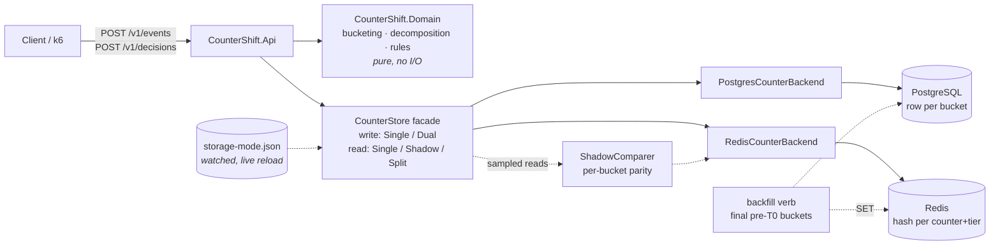

# CounterShift

A fraud-counter service that answers time-windowed questions such as *"more than 5 failed payments on this card in the last 10 minutes?"*, and then **migrates its own storage to a new design with zero downtime**.

It is a learning-scale rebuild of Grab's Counter Service and its 2026 storage migration. See [`docs/spec.md`](docs/spec.md) for the full specification.

> **Status:** Batches A and B complete (M0–M6). Working fraud service; storage behind a facade with PostgreSQL and Redis backends; live-reloadable dual-write, shadow, split and backfill migration machinery, verified end to end. Next: Batch C, observability and load-test rehearsal.

## Architecture



The migration plan and its runbook: [`docs/runbooks/migration.md`](docs/runbooks/migration.md).

## Quick start

Prerequisites: .NET SDK 10.0.4xx and Docker.

```bash
# 1. Start PostgreSQL (host port 55432) and Redis (host port 56379)
docker compose -f deploy/compose/docker-compose.yml up -d

# 2. Run the API (applies database migrations on startup)
ASPNETCORE_ENVIRONMENT=Development dotnet run --project src/CounterShift.Api --no-launch-profile --urls http://localhost:5072

# 3. Run all tests (integration tests start their own throwaway Postgres via Testcontainers)
dotnet test --solution CounterShift.slnx
```

## Repository map

| Path | What lives there |
|---|---|
| `src/CounterShift.Domain` | Pure logic: events, counters, buckets, window decomposition, rules |
| `src/CounterShift.Api` | HTTP host, configuration, composition root |
| `src/CounterShift.Storage` | Storage seam: `ICounterBackend`, `CounterStore` facade, in-memory backend |
| `src/CounterShift.Storage.Postgres` | Legacy backend: SQL, migrations, retention cleanup |
| `src/CounterShift.Storage.Redis` | New backend: one hash per counter and tier, Lua writes, native expiry |
| `tests/` | Unit, property and integration tests |
| `experiments/` | "Break" harnesses that measure failures (lost updates, deadlocks); results in `docs/results/` |
| `deploy/compose` | Local dependencies |
| `docs/spec.md` | What we build and why |
| `docs/learning/` | **Start here to learn**: one note per milestone (what, why, when, commands, self-check) |
| `docs/adr/` | Architecture decision records |
| `docs/glossary.md` | Every term, defined once |

## Learning path

Read the notes in [`docs/learning/`](docs/learning/README.md) in order. Each note links to the code and the decision records it introduced.
