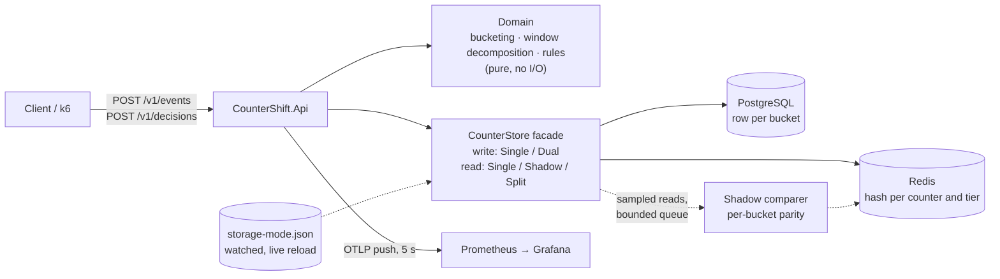
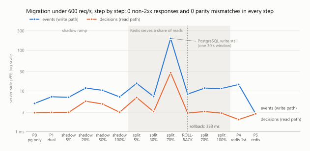
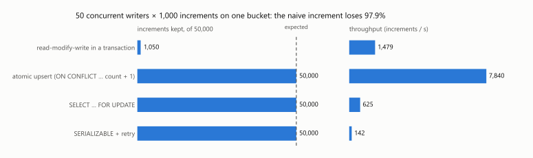
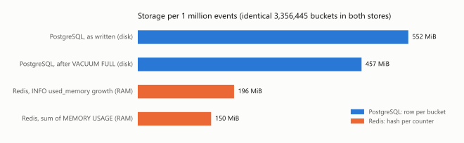

# CounterShift

[](https://github.com/Kar6677thik/CounterShift/actions/workflows/ci.yml)

A fraud-counter service that answers time-windowed questions such as *"more than 5 failed payments on this card in the last 10 minutes?"*, and migrates its own storage from PostgreSQL to Redis with zero downtime. Events are pre-aggregated into 1-minute, 15-minute, hourly and daily buckets, and each query is answered from the fewest buckets that cover its window. Storage sits behind a facade whose write mode (single or dual) and read mode (single, shadow or split) are changed at runtime by editing a watched configuration file, so a cutover or a rollback is a config edit rather than a deploy.

Built on ASP.NET Core 10, PostgreSQL 17 and Redis 8. Container images are published to GHCR on every merge to `main`.


<sub>Recorded from [`load/demo.sh`](load/demo.sh) against the Docker Compose stack. Every status code, count and timing is a real response.</sub>

## Architecture



An event is validated (event time, max 5 min late), turned into one increment per counter and tier, and written in a single atomic statement (PostgreSQL) or Lua script (Redis). A decision decomposes each rule's window into buckets, reads them all in one batched call, sums them and returns the most severe triggered outcome. Details: [spec §4–§7](docs/spec.md).

## How the migration works

| Phase | Writes | Reads | Undo |
|-------|--------|-------|------|
| 0 | PostgreSQL | PostgreSQL | |
| 1 | PostgreSQL, then Redis (Redis failures tolerated and counted) | PostgreSQL | stop dual writes |
| backfill | copies history that can no longer change into Redis (idempotent SET; run again after the current day closes) | | re-run |
| 2 | dual | PostgreSQL serves; a hashed 5→100% of counters are also read from Redis and compared per bucket | shadow off |
| 3 | dual | a hashed 5→100% of counters served by Redis | lower the percentage |
| 4 | Redis, then PostgreSQL | Redis | back to phase 3 |
| 5 | Redis | Redis | |

Unsafe combinations are rejected on reload, and the last valid mode stays in force: a store is never read unless it receives every write. Traffic is split by `XxHash64(counter key)`, so a card always reads from the same store and raising the percentage only adds keys. A difference in a closed bucket counts as a **mismatch**; one in a still-open bucket counts as an in-flight **race**. The gate for every step is zero mismatches. Full procedure: [runbook](docs/runbooks/migration.md).

## Results

Measured on a single machine (Intel Core Ultra 5 225H, Docker Desktop on WSL2), with the API, PostgreSQL, Redis, Prometheus and k6 all sharing it. Each linked file has the exact command and the raw output.

**Baselines: the failure modes the design addresses**

| Scenario | Result | Source |
|----------|--------|--------|
| Read-modify-write increments inside a transaction, 50 writers × 1,000 on one bucket | **1,050 of 50,000** increments kept (97.9% lost), plus 32 duplicate-key failures | [B1](docs/results/b1-lost-updates.md) |
| Multi-row upserts locking rows in a different order per statement | **297 of 300** statements deadlocked; 2,970 increments lost | [B5](docs/results/b5-deadlocks.md) |
| Splitting traffic with `string.GetHashCode()` | the same key landed in **3 different** rollout buckets in 3 processes | [B4](docs/results/b4-hash-stability.md) |
| Switching the backend by configuration alone, without migrating data | a card with 6 failed payments goes from `block` to **`allow`**, with no errors anywhere | [test](tests/CounterShift.Api.Tests/NaiveSwitchTests.cs) |

**Production design**

| Property | Result | Source |
|----------|--------|--------|
| Atomic upsert under the same contention | **50,000 of 50,000**, at 7,840 increments/s (5.3× the naive version) | [B1](docs/results/b1-lost-updates.md) |
| Consistent lock order | **0 deadlocks**; 0.09 s instead of 282 s | [B5](docs/results/b5-deadlocks.md) |
| Full migration (phases 0→5 and a rollback) under 600 req/s | **371,832 requests, 0 failed, 0 non-2xx** in every step; **0 parity mismatches** in 36,491 shadow comparisons | [rehearsal](docs/results/m8-rehearsal-local.md) |
| Config-only rollback (split 70% → PostgreSQL reads) | applied in **333 ms**, with no errors | [rehearsal](docs/results/m8-rehearsal-local.md) |
| Cost of dual writes | event p50 2.5 → 3.9 ms; decision latency unchanged by 100% shadow reads | [rehearsal](docs/results/m8-rehearsal-local.md) |
| PostgreSQL only → Redis only | event p99 **5.0 → 2.8 ms**; decision p50 1.5 → 0.7 ms | [rehearsal](docs/results/m8-rehearsal-local.md) |
| Storage per 1 million events (identical 3,356,445 buckets) | Redis **150 MiB** (RAM) vs PostgreSQL **457–552 MiB** (disk); writes 15,045 vs 4,792 events/s | [footprint](docs/results/m8-footprint.md) |

<picture>
  <source media="(prefers-color-scheme: dark)" srcset="docs/images/rehearsal-dark.svg">
  
</picture>

<picture>
  <source media="(prefers-color-scheme: dark)" srcset="docs/images/lost-updates-dark.svg">
  
</picture>

<picture>
  <source media="(prefers-color-scheme: dark)" srcset="docs/images/footprint-dark.svg">
  
</picture>

<sub>Charts generated by [`load/make_charts.py`](load/make_charts.py) from the recorded results.</sub>

**Known limitations**
- **One latency spike is unattributed.** During one 30-second step of the rehearsal, PostgreSQL write p99 rose to 193 ms: 234 of 6,002 writes took more than 50 ms. Redis reads in the same window were unaffected, and GC pauses were not the cause.
- **The backfill's second pass waits for real time.** It must run after the current day bucket closes, up to about a day after dual writes start. That timing is verified with a simulated clock, not over a live multi-day run.
- **Events are not deduplicated.** A retried event is counted twice ([ADR 0005](docs/adr/0005-no-dedup-in-v1.md)).
- **Redis durability is weaker.** With `appendfsync everysec`, Redis can lose up to about 1 s of increments on a crash.

## Run it

**Just Docker, nothing to build.** This uses the image CI publishes to GHCR:

```bash
git clone https://github.com/Kar6677thik/CounterShift.git && cd CounterShift
docker compose -f deploy/compose/docker-compose.yml -f deploy/compose/docker-compose.ghcr.yml up -d
curl -s -X POST localhost:8080/v1/events -H 'Content-Type: application/json' \
  -d '{"eventId":"7d6f6c1e-9a39-4f53-9b41-3c2b2b7c9a01","type":"payment.failed","occurredAt":"'$(date -u +%FT%TZ)'","entities":{"cardId":"c_42","userId":"u_7"}}'
curl -s -X POST localhost:8080/v1/decisions -H 'Content-Type: application/json' \
  -d '{"action":"payment","entities":{"cardId":"c_42","userId":"u_7"}}'
```

The first start pulls images and migrates the database. Give it about 20 s, or watch `curl localhost:8080/readyz`.

- **Grafana:** <http://localhost:53000>, dashboard "CounterShift: migration".
- **Admin view:** `curl localhost:8080/admin/storage-mode` shows the active mode and live parity counts.
- **Change modes:** edit `deploy/compose/mode/storage-mode.json`. To replay the demo, run `load/demo.sh` (needs bash, curl and Python 3). It edits the mode file and stops and restarts the Compose Redis.

**From source** (needs the .NET SDK 10.0.4xx):

```bash
dotnet test --solution CounterShift.slnx                       # 149 tests; integration tests use real PostgreSQL and Redis
docker compose -f deploy/compose/docker-compose.yml up -d --build
```

The backfill runs from the same image: `docker compose run --rm api backfill --from postgres --to redis --dual-write-since <T0>`.

The load test and rehearsal driver are [`load/traffic.js`](load/traffic.js) (k6) and [`load/rehearse.py`](load/rehearse.py). The experiments are in [`experiments/`](experiments/CounterShift.Experiments/Program.cs).

## What's inside

- **Counting:**
  - UTC-aligned 1m / 15m / 1h / 1d tiers. A window's start rounds outward to the finest tier still retained at that age, and buckets that end after "now" are used whole, so a "last 10 minutes" query reads 1–11 buckets ([ADR 0002](docs/adr/0002-granularities-and-rounding.md)).
  - Decomposition is proven minimal against a brute-force oracle with property tests.
  - Events are bucketed by event time, with lateness and skew bounds ([ADR 0003](docs/adr/0003-event-time-lateness-and-skew.md)).
- **Writes:**
  - one multi-row `INSERT … ON CONFLICT DO UPDATE` per event, rows ordered for a consistent lock order, and a bounded connection pool ([ADR 0006](docs/adr/0006-atomic-upsert-with-sorted-keys.md));
  - a Lua script with `HINCRBY` and per-field `HPEXPIREAT` in Redis ([ADR 0008](docs/adr/0008-redis-hash-backend.md)).
- **Storage seam:** `ICounterBackend` behind a `CounterStore` facade, with driver errors translated to `StorageUnavailableException` ([ADR 0007](docs/adr/0007-storage-seam.md)). One contract test suite runs against every backend, and architecture tests check that the API never references a database driver.
- **Migration:**
  - synchronous dual writes with tolerated secondary failures ([ADR 0009](docs/adr/0009-dual-write-semantics.md));
  - deterministic hash rollout ([ADR 0010](docs/adr/0010-rollout-hashing.md));
  - per-bucket parity behind a bounded, dropping queue ([ADR 0011](docs/adr/0011-parity-classification.md));
  - backfill of buckets that can no longer change ([ADR 0012](docs/adr/0012-backfill-final-pre-t0-buckets.md));
  - validated live reload ([ADR 0013](docs/adr/0013-runtime-mode-reload.md)).
- **Failure behaviour:** decisions fail closed with `503` when the store serving them is down ([ADR 0004](docs/adr/0004-fail-closed-decisions.md)). `/readyz` checks only the backends the current mode depends on, and `/healthz` checks the process.
- **Observability:** OpenTelemetry metrics pushed over OTLP to Prometheus ([ADR 0014](docs/adr/0014-otlp-push-to-prometheus.md)), covering latency per backend, operation and role, parity results, and decision outcomes. The Grafana dashboard is generated from code.
- **Tests:** xUnit v3 with Testcontainers (real PostgreSQL 17 and Redis 8, never mocked), FsCheck property tests, `FakeTimeProvider`, and an end-to-end migration test through the HTTP API, including a rollback.

## Documentation

- [Specification](docs/spec.md): domain model, API contract, storage designs, migration plan
- [Architecture decision records](docs/adr/): each significant decision, with the alternatives considered
- [Migration runbook](docs/runbooks/migration.md): every phase with its check and its undo
- [Results](docs/results/): commands, machine details and raw output for every measurement above
- [Glossary](docs/glossary.md)
